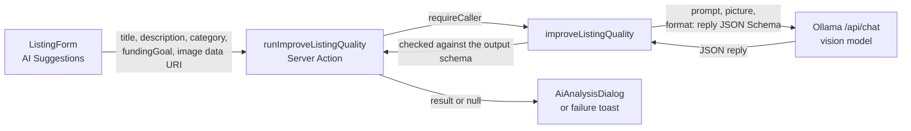
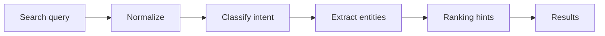
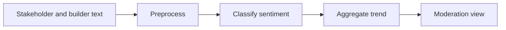

# AI Features

## Overview

blkfndr has one AI feature: an advisory review of a draft listing. On the create-listing form, the **AI Suggestions** button sends the draft to a vision model on an Ollama server, in one `/api/chat` request. The server can be self-hosted or Ollama Cloud. The builder gets back a quality score, suggestions, and any potential issues.

The review is advice for the builder and nothing more. The result is not stored, admins never see it, and it does not gate launch, admin approval, or anything on-chain.

Query analysis and sentiment tracking appear at the end of this page as design specs. Neither is implemented.

| Capability | State |
|---|---|
| Listing quality review (`improveListingQuality`) | Implemented |
| Query analysis | Not implemented — design spec |
| Sentiment tracking | Not implemented — design spec |

## What is implemented

| Piece | File | Role |
|---|---|---|
| Review | [src/ai/flows/improve-listing-quality.ts](../src/ai/flows/improve-listing-quality.ts) | The input and output schemas, the prompt, and `improveListingQuality()`, which makes the Ollama request and checks the reply |
| Tests | [src/ai/flows/improve-listing-quality.test.ts](../src/ai/flows/improve-listing-quality.test.ts) | The request and the reply checks against a stand-in for Ollama's `/api/chat`, part of `npm test`. No Ollama server needed |
| Server Action | [src/app/actions.ts](../src/app/actions.ts) | `runImproveListingQuality()`, the only caller of the review |
| Form | [src/components/create/ListingForm.tsx](../src/components/create/ListingForm.tsx) | The **AI Suggestions** button on `/create-listing` |
| Result dialog | [src/components/create/AiAnalysisDialog.tsx](../src/components/create/AiAnalysisDialog.tsx) | Shows the score, suggestions and issues |

### Request path



1. The builder picks a project image. The browser reads it into a base64 data URI. Without an image, the button shows "Add a picture first" and sends nothing.
2. The form sends the title, description, category, funding goal and image data URI to `runImproveListingQuality`.
3. The action calls `requireCaller()`, because every review costs GPU time, or Ollama Cloud quota. A signed-out caller gets `null`.
4. `improveListingQuality()` checks the input against the input schema, then sends one `POST {OLLAMA_BASE_URL}/api/chat`: the prompt with the listing details and the reply's JSON Schema, the picture as bare Base64 in `images`, `format` set to that same schema, `stream: false` and `think: false`.
5. It parses the model's reply as JSON and checks it against the output schema with zod before returning it. A reply that is not JSON, or does not fit, throws.
6. Any error is logged on the server as `AI analysis failed:` and returned as `null`. That covers a missing `OLLAMA_BASE_URL`, input that does not fit, an Ollama error, a timeout, and a reply that does not fit the schema. The form then shows "The quality check didn't answer".
7. On success, the dialog shows the score as a progress bar and `N/100`, then the suggestions. It shows a "Potential Issues" list only when `flags` is non-empty.

## Schemas

Copied from [src/ai/flows/improve-listing-quality.ts](../src/ai/flows/improve-listing-quality.ts). `z` is zod 4.

### Input

```typescript
/**
 * A picture as FileReader.readAsDataURL writes it, in a format Ollama's vision
 * models read. Ollama refuses AVIF ("Failed to load image"), so a picture in
 * any other format is refused here, before a request is made.
 */
const IMAGE_DATA_URI = /^data:image\/(?:png|jpeg|webp|gif);base64,([A-Za-z0-9+/]+={0,2})$/;

const TEXT_MAX = 10_000;

const ImproveListingQualityInputSchema = z.object({
  title: z.string().max(TEXT_MAX).describe('The title of the project listing.'),
  description: z.string().max(TEXT_MAX).describe('The detailed description of the project.'),
  category: z.string().max(200).describe('The category the project belongs to (e.g., Technology, Art, Charity).'),
  fundingGoal: z.number().describe('The total funding amount being sought for the project.'),
  imageUrl: z
    .string()
    .regex(IMAGE_DATA_URI, 'Expected a PNG, JPEG, WebP or GIF picture as a Base64 data URI')
    .describe("An image representing the project, as a data URI that must include a MIME type and use Base64 encoding. Expected format: 'data:<mimetype>;base64,<encoded_data>'."),
});
```

`TEXT_MAX` is well past every listing limit, so a draft that is over one still gets reviewed. It bounds what one press can send to the model.

The form accepts any `image/*`, but only PNG, JPEG, WebP and GIF reach the model. On 2026-10-27, Ollama 0.40.11 with `gemma4:12b` read all four and answered 400 to AVIF. A builder with an AVIF or HEIC picture gets the failure toast, and no request is made.

What the form actually sends:

| Field | Source |
|---|---|
| `title`, `description` | The form fields as typed |
| `category` | The category picked from the form's list |
| `fundingGoal` | The form's goal, which is the sum of the milestone amounts. Whole token units, not stroops |
| `imageUrl` | A `data:` URI read from the selected file. Never an IPFS URL — the image is pinned to IPFS only at launch |

### Output

```typescript
const ImproveListingQualityOutputSchema = z.object({
  suggestions: z
    .array(z.string().describe('Specific suggestions for improving the listing.'))
    .max(10)
    .describe('A list of AI-powered suggestions to enhance the project listing.'),
  flags: z
    .array(z.string().describe('Potential issues or concerns identified in the listing.'))
    .max(10)
    .describe('A list of potential issues or concerns that need review.'),
  overallQualityScore: z
    .number()
    .int()
    .min(0)
    .max(100)
    .describe('An overall quality score (0-100) for the listing based on AI analysis.'),
});
```

The same schema does three jobs. `z.toJSONSchema()` turns it into a JSON Schema, minus `$schema`. That schema goes to Ollama as `format`, which Ollama turns into a grammar the model's output has to follow. The model never reads `format`, so the prompt carries the schema too, with its descriptions. zod then checks the reply against the schema, so the bounds hold even where the grammar does not enforce them.

## Model and configuration

| Setting | Value |
|---|---|
| Server | `OLLAMA_BASE_URL`, e.g. `http://127.0.0.1:11434` for `npm run dev`, `http://host.docker.internal:11434` from the Docker stack to Ollama on the same host, or `https://ollama.com` for Ollama Cloud. Unset turns the review off |
| Model | `OLLAMA_MODEL`, default `gemma4:12b`. It must read pictures (Ollama lists `vision` among its capabilities) and be pulled on the server |
| Key | `OLLAMA_API_KEY`, sent as `Authorization: Bearer`. Only for Ollama Cloud, or a proxy in front of a self-hosted server. Server-only — never prefix it `NEXT_PUBLIC_` |
| Thinking | Off (`think: false`). The answer is held to the schema anyway, and thinking first only adds time |
| Retries and timeout | No retries. A 90-second timeout, because Cloudflare in front of blkfndr.com drops a request after 100 seconds: giving up first means the builder sees the form's toast, not an error from Cloudflare |
| Package | None. The review calls Ollama's REST API with `fetch` |

All three are runtime variables. In Docker, [docker-compose.yml](../docker-compose.yml) passes them to the app container, so setting or changing one needs a redeploy, not a rebuild. Compose also maps `host.docker.internal` to the Docker host, which Docker Desktop does by itself and Linux does not. Ollama on the host has to listen beyond loopback for the container to reach it: set `OLLAMA_HOST=0.0.0.0` where Ollama runs, and keep port 11434 closed to the internet, because Ollama has no authentication of its own.

### Choosing a model

Measured on 2026-10-27 against the owner's local Ollama 0.40.11, with one sample draft and the BLKFNDR emblem as its picture:

| Model | Review time | Notes |
|---|---|---|
| `gemma4:12b` (default, 8 GB) | 15–17 s once loaded; loading it took about 40 s | A valid reply, score 65. It flagged that the picture is a logo, not the project |
| `gemma4:26b` (19 GB) | 45 s, 30 s of it loading the model | A valid reply, score 45, with similar points |
| `qwen3.8` (18 GB) | Timed out at 90 s while loading | Too slow to load on this machine |

Ollama unloads a model after 5 minutes idle by default, so the first review after a quiet spell includes the load. A larger model's load can push the review past the 90-second timeout. `OLLAMA_KEEP_ALIVE` on the Ollama side keeps the model loaded for longer.

### When `OLLAMA_BASE_URL` is unset

The app starts and the review module imports normally. Each call then fails, before anything is sent, with:

```
OLLAMA_BASE_URL is not set, so the listing review is off
```

The action catches this and returns `null`, so the builder sees "The quality check didn't answer". Nothing else in the app depends on the feature. [Deployment](deployment.md#ai-listing-review-does-nothing) lists the other errors and their fixes.

### Limits

- **Sign-in only.** There is no other rate limit or quota in the app.
- **Image size.** The image travels as base64 inside the Server Action request. Next.js caps Server Action bodies at 1 MB by default, and [next.config.js](../next.config.js) does not raise it. Base64 adds a third, so an image over roughly 750 KB pushes the request over the cap. Next.js refuses it with a 413 before the action runs.
- **No retry and no fallback.** One failed model call is one failed review.

## Local development

With Ollama running on your machine and the model pulled (`ollama pull gemma4:12b`), set `OLLAMA_BASE_URL=http://127.0.0.1:11434` in `.env.local`. `npm run dev` then sends **AI Suggestions** to your local Ollama. `npm test` covers the request and the reply checks without an Ollama server.

## Adding a feature

1. Create a file in `src/ai/flows/`. Define the input and output schemas with zod, check the input against its schema, send the request to `${OLLAMA_BASE_URL}/api/chat` with the output schema as `format` and in the prompt, and check the reply against the output schema before returning it. Send `OLLAMA_API_KEY` as a bearer token when it is set, and give the request a timeout under Cloudflare's 100 seconds.
2. Do not make it a `"use server"` module. Expose it only through a guarded Server Action or route handler, the way `runImproveListingQuality` does. Every exported async function in a `"use server"` file is a public endpoint, so the wrapper authenticates the caller, validates its input, and catches errors.
3. Bound every array in its schemas with `.max()`. [src/lib/zod-collections.test.ts](../src/lib/zod-collections.test.ts) fails on a zod collection in server code until it is listed there with its bound.
4. Never import it into a client component, other than its types with `import type`.

---

## Design specs (not implemented)

These sections describe possible features. None of the flows, files or contracts below exist in the codebase.

### Query analysis

**Not implemented — design spec.**

**Today:** search is a case-insensitive substring match, with no model involved. The header search ([src/components/layout/HeaderSearch.tsx](../src/components/layout/HeaderSearch.tsx)) loads `/api/projects` and matches each project's title and tagline. The `/projects?q=` page ([src/app/projects/page.tsx](../src/app/projects/page.tsx)) also matches the description.

**Purpose:** read the intent behind a search, such as a category, a place or a risk concern, so results rank by what the person meant rather than by literal text.



Proposed contracts:

```typescript
interface QueryAnalysisInput {
  query: string;
  locale?: string;
}

interface QueryAnalysisOutput {
  normalizedQuery: string;
  intent: 'discover' | 'compare' | 'stake' | 'research' | 'other';
  entities: Array<{ type: 'category' | 'location' | 'risk'; value: string }>;
  confidence: number; // 0-1
  rankingHints: string[];
}
```

Guidance:

- Run it behind a guarded Server Action, like the listing review.
- Apply ranking hints as soft boosts, never as filters, so a bad answer cannot hide a project.
- Drop low-confidence entities instead of showing them.

### Sentiment tracking

**Not implemented — design spec.**

**Today:** the platform has no comments or project-update feed, so there is no text to classify yet. The nearest sources are milestone proof text and community feature requests.

**Purpose:** summarize how stakeholders feel about a project over time, as one signal for moderators alongside on-chain activity.



Proposed contracts:

```typescript
interface SentimentTrackingInput {
  projectId: string;
  messages: Array<{
    id: string;
    authorRole: 'builder' | 'stakeholder' | 'admin';
    text: string;
    createdAt: string;
  }>;
}

interface SentimentTrackingOutput {
  projectId: string;
  overall: 'positive' | 'neutral' | 'negative';
  score: number; // -1 to +1
  trends: Array<{ window: '24h' | '7d' | '30d'; score: number }>;
  alerts: string[];
}
```

Guidance:

- Read it next to on-chain activity, never on its own.
- Never take a moderation action, such as hiding or locking a project, from a sentiment score alone. Those stay with the admins.
- Sentiment has no part in votes or releases. Those are decided by stakeholders on-chain.
