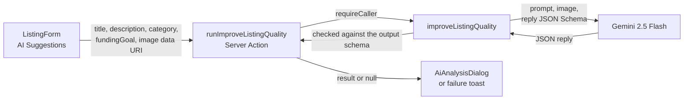
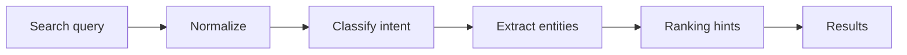
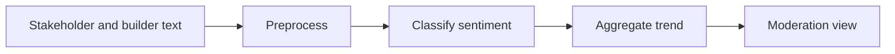

# AI Features

## Overview

blkfndr has one AI feature: an advisory review of a draft listing. On the create-listing form, the **AI Suggestions** button sends the draft to Gemini in one call through Google's Gen AI SDK (`@google/genai`). The builder gets back a quality score, suggestions, and any potential issues.

The review is advice for the builder and nothing more. The result is not stored, admins never see it, and it does not gate launch, admin approval, or anything on-chain.

Query analysis and sentiment tracking appear at the end of this page as design specs. Neither is implemented.

| Capability | State |
|---|---|
| Listing quality review (`improveListingQuality`) | Implemented |
| Query analysis | Not implemented — design spec |
| Sentiment tracking | Not implemented — design spec |

## What is implemented

| Piece | File | Role |
|---|---|---|
| Review | [src/ai/flows/improve-listing-quality.ts](../src/ai/flows/improve-listing-quality.ts) | The input and output schemas, the prompt, and `improveListingQuality()`, which makes the Gemini call and checks the reply |
| Tests | [src/ai/flows/improve-listing-quality.test.ts](../src/ai/flows/improve-listing-quality.test.ts) | The request and the reply checks against a stand-in for the Gemini API, part of `npm test`. Nothing reaches Google |
| Server Action | [src/app/actions.ts](../src/app/actions.ts) | `runImproveListingQuality()`, the only caller of the review |
| Form | [src/components/create/ListingForm.tsx](../src/components/create/ListingForm.tsx) | The **AI Suggestions** button on `/create-listing` |
| Result dialog | [src/components/create/AiAnalysisDialog.tsx](../src/components/create/AiAnalysisDialog.tsx) | Shows the score, suggestions and issues |

### Request path



1. The builder picks a project image. The browser reads it into a base64 data URI. Without an image, the button shows "Add a picture first" and sends nothing.
2. The form sends the title, description, category, funding goal and image data URI to `runImproveListingQuality`.
3. The action calls `requireCaller()`, because every call is billed. A signed-out caller gets `null`.
4. `improveListingQuality()` checks the input against the input schema, then sends one `generateContent` request: the prompt with the listing details, the image as inline data, and the output schema as the reply's JSON Schema (`responseMimeType: application/json`).
5. It parses the reply as JSON and checks it against the output schema with zod before returning it. A reply that is not JSON, or does not fit, throws.
6. Any error is logged on the server as `AI analysis failed:` and returned as `null`. That covers a missing key, input that does not fit, a provider failure, a blocked reply and a reply that does not fit the schema. The form then shows "The quality check didn't answer".
7. On success, the dialog shows the score as a progress bar and `N/100`, then the suggestions. It shows a "Potential Issues" list only when `flags` is non-empty.

## Schemas

Copied from [src/ai/flows/improve-listing-quality.ts](../src/ai/flows/improve-listing-quality.ts). `z` is zod 4.

### Input

```typescript
/** A picture as FileReader.readAsDataURL writes it: the MIME type, then the Base64 bytes. */
const IMAGE_DATA_URI = /^data:(image\/[\w.+-]+);base64,([A-Za-z0-9+/]+={0,2})$/;

const TEXT_MAX = 10_000;

const ImproveListingQualityInputSchema = z.object({
  title: z.string().max(TEXT_MAX).describe('The title of the project listing.'),
  description: z.string().max(TEXT_MAX).describe('The detailed description of the project.'),
  category: z.string().max(200).describe('The category the project belongs to (e.g., Technology, Art, Charity).'),
  fundingGoal: z.number().describe('The total funding amount being sought for the project.'),
  imageUrl: z
    .string()
    .regex(IMAGE_DATA_URI, 'Expected an image as a Base64 data URI')
    .describe("An image representing the project, as a data URI that must include a MIME type and use Base64 encoding. Expected format: 'data:<mimetype>;base64,<encoded_data>'."),
});
```

`TEXT_MAX` is well past every listing limit, so a draft that is over one still gets reviewed. It bounds what one press can send to the model.

What the form actually sends:

| Field | Source |
|---|---|
| `title`, `description` | The form fields as typed |
| `category` | The category picked from the form's list |
| `fundingGoal` | The form's goal, which is the sum of the milestone amounts. Whole token units, not stroops |
| `imageUrl` | A `data:` URI read from the selected file. Never an IPFS URL — the image is pinned to IPFS only at launch |

### Output

```typescript
const ImproveListingQualityOutputSchema = z.object({
  suggestions: z
    .array(z.string().describe('Specific suggestions for improving the listing.'))
    .max(10)
    .describe('A list of AI-powered suggestions to enhance the project listing.'),
  flags: z
    .array(z.string().describe('Potential issues or concerns identified in the listing.'))
    .max(10)
    .describe('A list of potential issues or concerns that need review.'),
  overallQualityScore: z
    .number()
    .int()
    .min(0)
    .max(100)
    .describe('An overall quality score (0-100) for the listing based on AI analysis.'),
});
```

The same schema does both jobs. `z.toJSONSchema()` turns it into the JSON Schema sent with the request, minus `$schema`, which is not a keyword Gemini lists. Gemini enforces `maxItems`, `minimum` and `maximum`, and reads the descriptions as instructions. zod then checks the reply against it, so the bounds hold even if the model ignores them.

## Model and configuration

| Setting | Value |
|---|---|
| Model | `gemini-2.5-flash`, the `MODEL` constant in [src/ai/flows/improve-listing-quality.ts](../src/ai/flows/improve-listing-quality.ts) |
| Package | `@google/genai`, Google's Gen AI SDK. It runs only on the server: the form imports the review's types, never the module |
| API key | `GEMINI_API_KEY`, passed to the SDK explicitly. `GOOGLE_API_KEY` is not used, though the SDK would prefer it if left to read the environment itself. Server-only — never prefix it `NEXT_PUBLIC_` |
| Retries and timeout | No retries, and a 60-second timeout. The SDK retries only when given `retryOptions`, so one press is one billable call |

The old names `GOOGLE_GENERATIVEAI_API_KEY` and `GOOGLE_GENAI_API_KEY` are not read by anything. If `GOOGLE_API_KEY` is set as well, the SDK logs "Both GOOGLE_API_KEY and GEMINI_API_KEY are set. Using GOOGLE_API_KEY." That message is wrong here: the key it is given, `GEMINI_API_KEY`, is the one it sends.

In Docker, [docker-compose.yml](../docker-compose.yml) passes `GEMINI_API_KEY` to the app container at runtime. It is not a build argument, so setting or changing it needs a redeploy, not a rebuild.

### When `GEMINI_API_KEY` is unset

The app starts and the review module imports normally. Each call then fails, before anything is sent, with:

```
GEMINI_API_KEY is not set, so the listing review is off
```

The action catches this and returns `null`, so the builder sees "The quality check didn't answer". Nothing else in the app depends on the feature.

### Limits

- **Sign-in only.** There is no other rate limit or quota in the app.
- **Image size.** The image travels as base64 inside the Server Action request. Next.js caps Server Action bodies at 1 MB by default, and [next.config.js](../next.config.js) does not raise it. Base64 adds a third, so an image over roughly 750 KB pushes the request over the cap. Next.js refuses it with a 413 before the action runs.
- **No retry and no fallback.** One failed model call is one failed review.

## Local development

`npm run dev` reads `GEMINI_API_KEY` from `.env.local`, and the **AI Suggestions** button on `/create-listing` then makes real, billable calls. `npm test` covers the request and the reply checks without one.

## Adding a feature

1. Create a file in `src/ai/flows/`. Define the input and output schemas with zod, check the input against its schema, call Gemini through `@google/genai` with the output schema as `responseJsonSchema`, and check the reply against the output schema before returning it. Pass `GEMINI_API_KEY` as `apiKey`.
2. Do not make it a `"use server"` module. Expose it only through a guarded Server Action or route handler, the way `runImproveListingQuality` does. Every exported async function in a `"use server"` file is a public endpoint, so the wrapper authenticates the caller, validates its input, and catches errors.
3. Bound every array in its schemas with `.max()`. [src/lib/zod-collections.test.ts](../src/lib/zod-collections.test.ts) fails on a zod collection in server code until it is listed there with its bound.
4. Never import it into a client component, other than its types with `import type`.

---

## Design specs (not implemented)

These sections describe possible features. None of the flows, files or contracts below exist in the codebase.

### Query analysis

**Not implemented — design spec.**

**Today:** search is a case-insensitive substring match, with no model involved. The header search ([src/components/layout/HeaderSearch.tsx](../src/components/layout/HeaderSearch.tsx)) loads `/api/projects` and matches each project's title and tagline. The `/projects?q=` page ([src/app/projects/page.tsx](../src/app/projects/page.tsx)) also matches the description.

**Purpose:** read the intent behind a search, such as a category, a place or a risk concern, so results rank by what the person meant rather than by literal text.



Proposed contracts:

```typescript
interface QueryAnalysisInput {
  query: string;
  locale?: string;
}

interface QueryAnalysisOutput {
  normalizedQuery: string;
  intent: 'discover' | 'compare' | 'stake' | 'research' | 'other';
  entities: Array<{ type: 'category' | 'location' | 'risk'; value: string }>;
  confidence: number; // 0-1
  rankingHints: string[];
}
```

Guidance:

- Run it behind a guarded Server Action, like the listing review.
- Apply ranking hints as soft boosts, never as filters, so a bad answer cannot hide a project.
- Drop low-confidence entities instead of showing them.

### Sentiment tracking

**Not implemented — design spec.**

**Today:** the platform has no comments or project-update feed, so there is no text to classify yet. The nearest sources are milestone proof text and community feature requests.

**Purpose:** summarize how stakeholders feel about a project over time, as one signal for moderators alongside on-chain activity.



Proposed contracts:

```typescript
interface SentimentTrackingInput {
  projectId: string;
  messages: Array<{
    id: string;
    authorRole: 'builder' | 'stakeholder' | 'admin';
    text: string;
    createdAt: string;
  }>;
}

interface SentimentTrackingOutput {
  projectId: string;
  overall: 'positive' | 'neutral' | 'negative';
  score: number; // -1 to +1
  trends: Array<{ window: '24h' | '7d' | '30d'; score: number }>;
  alerts: string[];
}
```

Guidance:

- Read it next to on-chain activity, never on its own.
- Never take a moderation action, such as hiding or locking a project, from a sentiment score alone. Those stay with the admins.
- Sentiment has no part in votes or releases. Those are decided by stakeholders on-chain.
